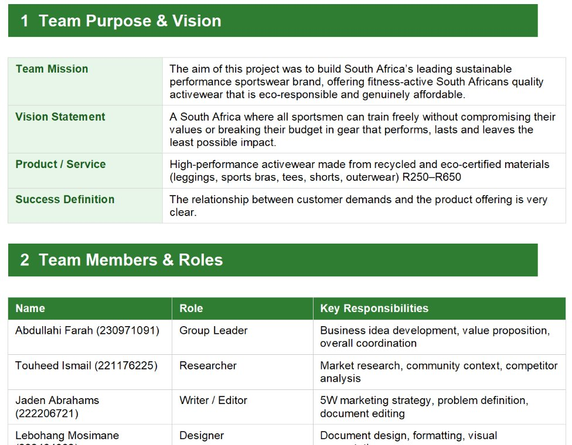
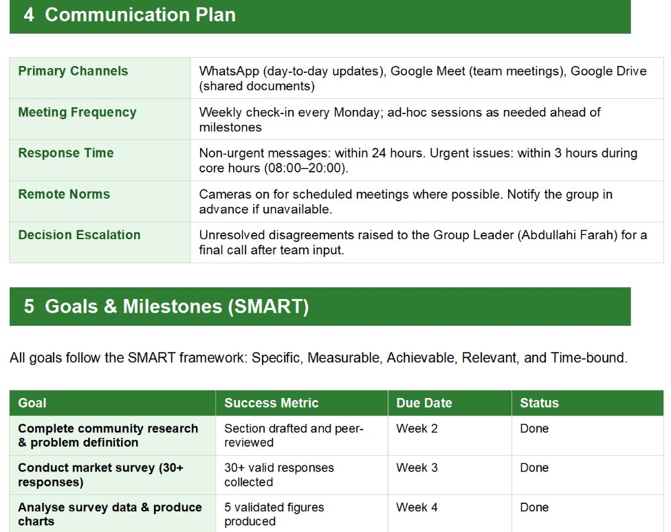

# 👋 Hi, I'm Lebohang Mosimane

🎓 ICT Student at CPUT  
💻 Aspiring UX Designer | Front-End Developer  
🎨 Creative Developer  

📍 Cape Town, South Africa  
📧 222464062@mycput.ac.za  
🔗 [GitHub](https://github.com/Lebohang7) · [LinkedIn](https://linkedin.com/in/lebohang-mosimane-9a8128272)

🌐 **Live website version of this portfolio:** [lebohang7.github.io/Portfolio-](https://lebohang7.github.io/Portfolio-/)

---

## Contents

1. [About me](#about-me)
2. [Evidence: GitHub account, Markdown CV, GitHub Pages](#portfolio-evidence)
3. [Agile project: ActiveEdge](#agile-project-activeedge-prp372s)
4. [Mock interview video](#mock-interview-video)
5. [Reflections (STAR)](#reflections-star)

---

## About Me
I am an aspiring **UX Designer and Front-End Developer** currently studying Information and Communication Technology at the Cape Peninsula University of Technology (CPUT).

I am passionate about creating **user-friendly, visually appealing, and impactful digital experiences**. My work focuses on solving real-world problems through design, research, and technology.

## Education
**Diploma in Information and Communication Technology**  
Cape Peninsula University of Technology (CPUT)  
2023 – Present

## Projects

### Smart To-Do List Application
- Developed a task management web app using JavaScript
- Implemented task prioritization and interactive UI
- Applied project management principles in development

### The Voices of Khayelitsha (Podcast)
- Created a podcast addressing social issues like crime and gangsterism
- Conducted interviews and audio storytelling
- Focused on community-driven digital solutions

### Massive Dynamics (Brand Identity Project)
- Designed a complete brand identity including logo and guidelines
- Developed visual systems (typography, color palette)
- Applied design thinking and branding strategies

## Technical Skills
- HTML, CSS, JavaScript
- Responsive Web Design
- UI/UX Design Principles
- Figma & Adobe XD
- Markdown, Git and GitHub
- Trello (Kanban) and Agile practices

## Career Objective
To grow as a **UX Designer and Front-End Developer**, contributing to innovative digital solutions while continuously improving my skills in design, development, and user experience.

---

## Portfolio Evidence

### GitHub student account
My GitHub account hosts this repository. Every change is saved as a commit, which gives a timestamped history of my work: [github.com/Lebohang7](https://github.com/Lebohang7)

### CV coded in Markdown
This README is my CV coded in Markdown. Headings (`#`), bold text (`**`), bullet lists (`-`), dividers (`---`), links and images are all written as plain text symbols. Click the **Code** view of this file (the `<>` icon above the README, or the pencil icon) to see the Markdown source.

### Published on GitHub Pages
This portfolio is also published as a live website with GitHub Pages: [lebohang7.github.io/Portfolio-/](https://lebohang7.github.io/Portfolio-/)

---

# Agile Project: ActiveEdge (PRP372S)

ActiveEdge is a group project to build South Africa's leading sustainable performance sportswear brand: eco-responsible activewear that is genuinely affordable (R250 to R650). Below is the Agile evidence from the project, each followed by my reflection.

---

## 1. Agile Team Charter

### Evidence

**Figure 1: Team purpose and vision, and team members and roles**

**Figure 2: Communication plan**

**Figure 3: SMART goals, success metrics, due dates and status**

### Full document: ActiveEdge Team Charter (PDF)

📄 [Open the full PDF](pdfs/ActiveEdge_Team_Charter.pdf)

### Reflection: Agile Team Charter

**Situation**  
Our group was building the ActiveEdge business case and needed a clear, shared agreement on how we would work together as a team of several members with different roles.

**Task**  
As the team's Designer, I was responsible for document design, formatting and visual presentation, and I had to make sure the charter covered all five required components in a form the whole team could use.

**Action**  
I helped structure the charter into seven numbered sections with clear headings and tables: purpose and vision, members and roles, team values and Agile principles, a communication plan (WhatsApp for daily updates, Google Meet for meetings, Google Drive for documents, a weekly Monday check-in), SMART goals with status tracking, ways of working, and a team commitment page that every member signed.

**Result**  
The charter gave us shared values (respect, transparency, accountability, trust and a learning mindset), response-time rules, a decision-making process with an escalation route to the Group Leader, and measurable goals with visible progress. I learned that agreeing expectations early reduces friction later, and that good layout makes a document far easier to use.

---

## 2. User Stories and Tasks

### Evidence

Each user story describes a piece of work from the user's or team's point of view. In Trello, every story card carries a checklist of tasks, for example 7/7 complete.

**Figure 4: Trello board with story cards and task checklists**

**Figure 5: User stories written in the Agile logbook taskboard**

### Reflection: User Stories and Tasks

**Situation**  
Our project work was tracked on a Trello board called ActiveEdge, where each card was tagged with a sprint, for example "[Sprint 1] Conduct market research on SA sportswear".

**Task**  
I needed to understand how a user story is written and how to break it into smaller tasks that the team could finish and tick off.

**Action**  
We wrote stories such as "Design a professional logo that accurately represents the ActiveEdge brand identity" and gave each Trello card a checklist of tasks. As tasks were completed, the checklist counter (such as 6/7) showed progress at a glance.

**Result**  
Completed cards reached 7/7 and moved to the Completed list. Breaking stories into small tasks made large pieces of work feel manageable and made progress measurable for everyone.

---

## 3. Product Backlog

### Evidence

The product backlog is the prioritised list of everything the product still needs. Our Trello Product Backlog held 63 cards when I took the screenshot.

**Figure 6: Trello Product Backlog list**

**Figure 7: Product Backlog column in the logbook, with user stories and their sprints**

### Reflection: Product Backlog

**Situation**  
The ActiveEdge project had a large amount of work: research, brand identity, product range and the website itself, all needing to be organised.

**Task**  
Keep one clear, prioritised list of everything outstanding so the team always knew what could be picked up next.

**Action**  
We kept the backlog in the first Trello list, with cards tagged by sprint (for example Sprint 4 cards such as choosing the brand colour palette and typography, and creating the size guide). In the logbook, stories such as the logo, product images and expanded website sections were added after lecturer feedback, followed by stories to document the business model and define the solution architecture.

**Result**  
The backlog stayed a living document that changed as feedback arrived. I learned that a backlog is never finished: it is reprioritised as the team learns more about what the product needs.

---

## 4. Sprint Backlog

### Evidence

The sprint backlog is the work the team commits to in the current sprint. On the board, it is the cards in In progress and Completed.

**Figure 8: Sprint work in Trello: 2 cards in progress, 12 completed**

**Figure 9: Sprint work recorded in the logbook (In Progress and Completed)**

### Reflection: Sprint Backlog

**Situation**  
Work was organised into sprints, such as "Final Feedback & Foundation (4 to 5 August)", "Visual Assets (5 August)" and "Architecture & Model (7 August)" in the logbook, and Sprint 1 to Sprint 4 in Trello.

**Task**  
Choose a realistic amount of work from the product backlog for each sprint and track it until it was done.

**Action**  
Cards were moved from the Product Backlog into In progress when work started, and into Completed when every task was ticked. At the time of the screenshot, the logo (6/7 tasks) and mood board were in progress, while earlier Sprint 1 cards such as market research and the SWOT analysis were done. The logbook also holds a board walkthrough that asks four questions: what we need to do to advance the work, whether anyone is working on something that is not on the board, what we need to finish as a team, and whether anything is blocking the flow of work.

**Result**  
Keeping only a few cards in progress at once kept the team focused. I learned that a sprint is about finishing a small set of work properly instead of starting everything at once.

---

## 5. Agile Logbook

### Evidence

The logbook records daily stand-ups. Each entry answers three questions: what did I complete, what will I do next, and what is blocking me.

**Figure 10: Daily stand-up entries, 3 to 5 August 2026**

### Full document: Agile Logbook (PDF)

📄 [Open the full PDF](pdfs/Agile_Logbook.pdf)

### Reflection: Agile Logbook

**Situation**  
During the build phase, the team needed a daily record of progress, plans and problems that everyone could look back on.

**Task**  
Complete the logbook honestly each day using the three stand-up questions, including days with no project work, such as the online classes on 3 August.

**Action**  
On 4 August I recorded the lecturer's feedback (a more professional logo, more product images and further developed website sections), the plan to build the real website using that feedback, and the risk that sourcing the logo and images could be difficult, which we handled by sharing responsibilities. On 5 August the log shows the move from the prototype to building the website. The entries for 6 and 7 August record how we coordinated code changes made at the same time through regular team discussions, and how we reviewed business and technical milestones while balancing business expectations against technical limitations.

**Result**  
The logbook kept a clear record of decisions and why we made them. I learned that naming impediments early is what allows the team to solve them, and that short daily notes are more useful than long summaries written at the end.

---

## Mock Interview Video

Recorded during work readiness training.

<!-- DRAG YOUR MOCK INTERVIEW .MP4 FILE ONTO THIS LINE WHILE EDITING THIS FILE ON GITHUB. GitHub will insert a link that shows a video player. -->

---

## Reflections (STAR)

### Reflection: Coding my CV in Markdown

**Situation**  
For the digital portfolio assignment I had to create and present my CV in Markdown on GitHub. I had always used word processors, so writing plain-text symbols and trusting them to turn into a formatted page was new to me.

**Task**  
Convert a traditional CV into a structured, professional and easy-to-read digital document without losing any important information.

**Action**  
I researched Markdown syntax and used the student guide to learn headings, bullet points, bold text, dividers and links. I planned the sections first (personal details, about me, education, projects, skills, career objective), kept the formatting consistent, and previewed the file after changes to fix spacing and list problems.

**Result**  
I produced a clean, well-organised CV that is available online. I learned that structure matters as much as content, and that checking the preview often saves time. I have since taken it further by rebuilding the portfolio as a website with HTML and CSS for more control over layout.

### Reflection: Mock interview

**Situation**  
During work readiness training I took part in a mock interview that simulated a real job interview, to prepare me for future employment.

**Task**  
Answer questions confidently, communicate clearly and behave professionally throughout.

**Action**  
I practised answers to common interview questions and worked on my communication. During the interview I kept eye contact, spoke clearly, structured my answers and stayed calm when questions were challenging.

**Result**  
The interview built my confidence and showed me how to present myself professionally. Because it is recorded, I now have evidence I can watch back and use to keep improving before a real interview.

### Reflection: Publishing with GitHub Pages

**Situation**  
I had to publish my digital portfolio with GitHub Pages so that my repository became a live website anyone could open with a link.

**Task**  
Configure GitHub Pages correctly and make sure the content was structured and displayed properly online.

**Action**  
I enabled Pages in the repository settings, chose the branch to deploy from, and tested the published link. When I added screenshots, my first attempt showed a 404 error because the images folder was not in the repository where the page expected it. I learned that file paths are relative to the repository, so I fixed it by uploading the images into the correct folder.

**Result**  
My portfolio is live and updates whenever I commit a change. I gained practical knowledge of web deployment, file paths and troubleshooting, and I now check the live link after every update.
